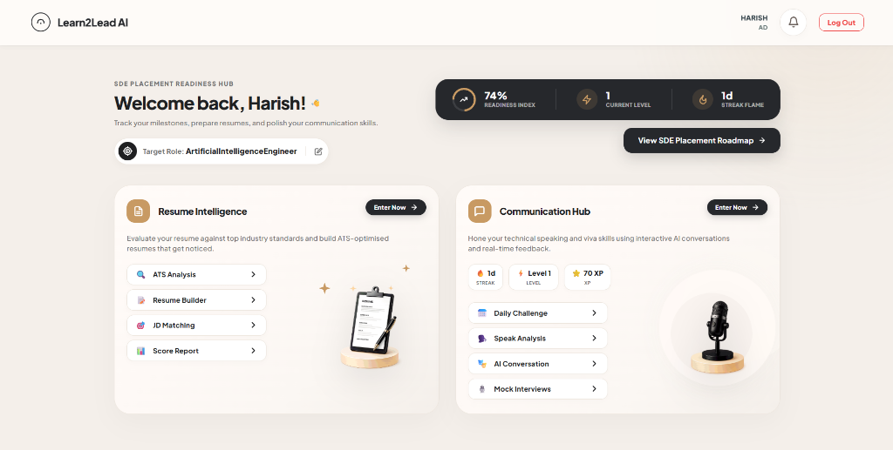
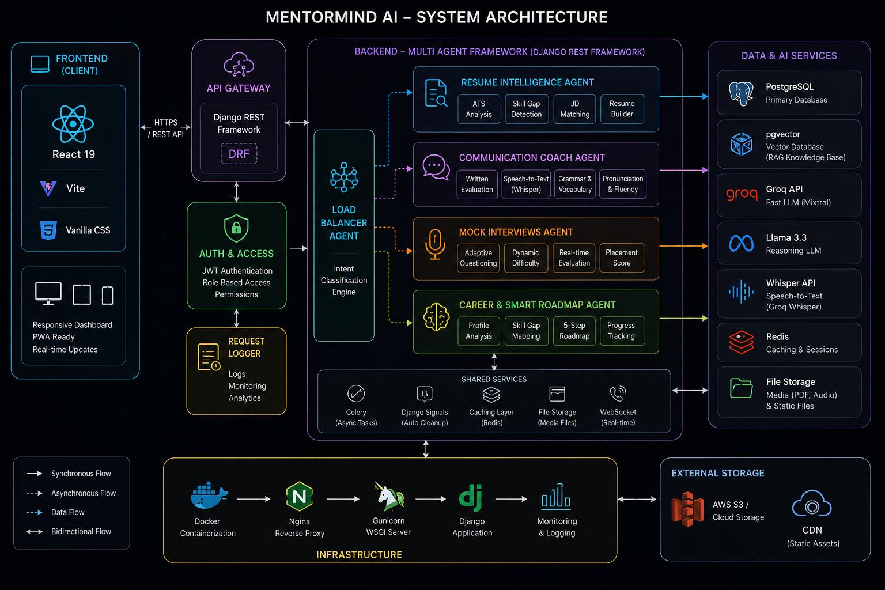
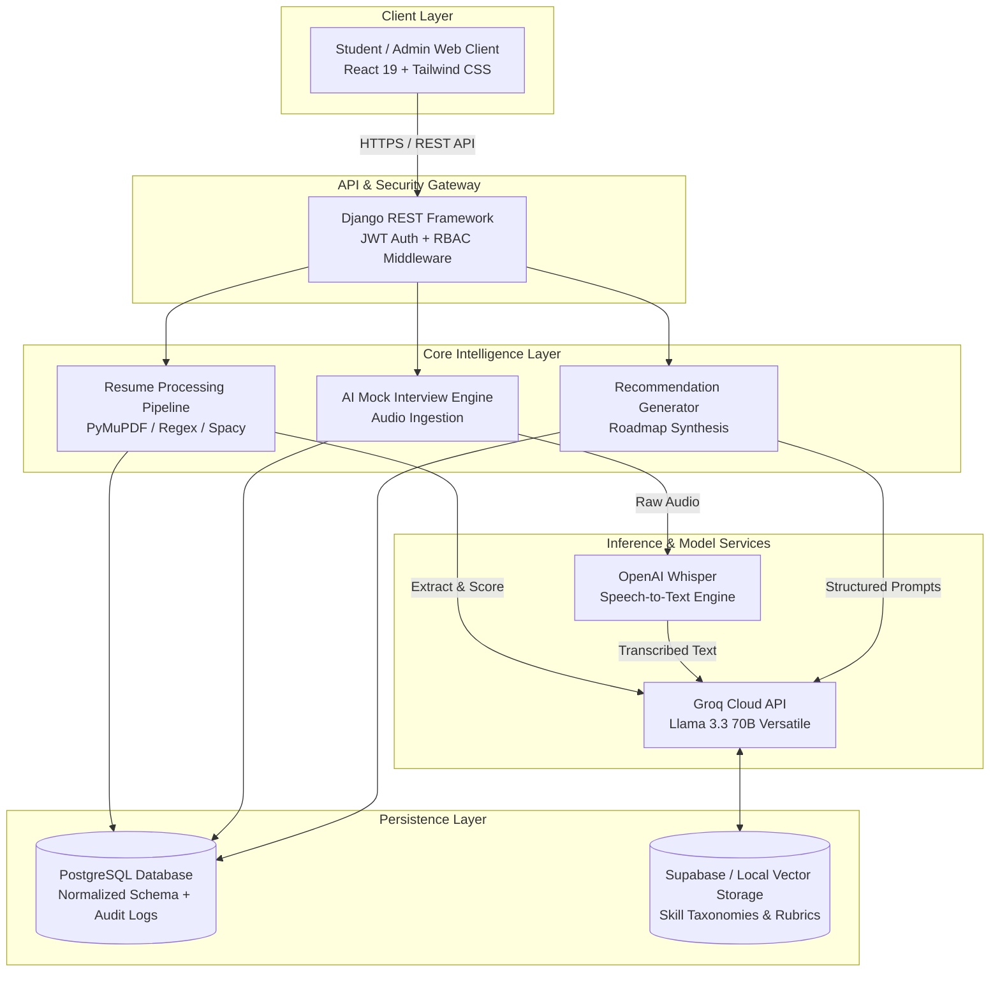
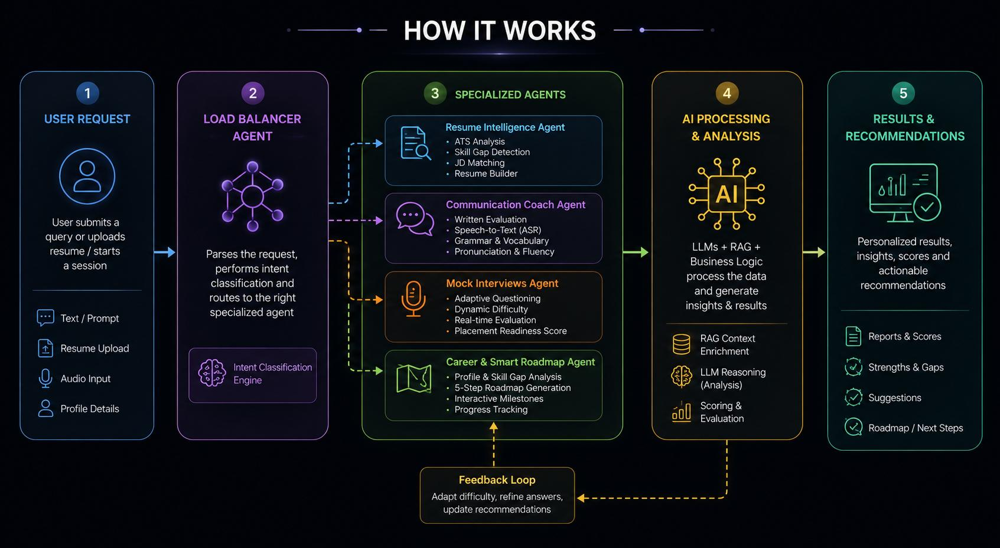

# 🚀 Learn2Lead AI
### *Autonomous AI Career Readiness & Interview Intelligence Platform*

[**Explore Live Platform 🌐**](https://learn2lead.ramcoad.com) • [**System Architecture 🏛️**](#system-architecture) • [**Key Features ⚡**](#features) • [**Impact & Metrics 📈**](#impact)

 

---

## 📌 The Problem

At most engineering institutions, students face three critical hurdles during placement drives:
1. **The ATS "Black Box":** Students submit resumes without knowing how automated Application Tracking Systems (ATS) score keyword density, section structuring, or skill alignments.
2. **Generic Placement Training:** Career training is usually "one-size-fits-all," failing to diagnose candidate-specific technical and conceptual skill gaps for target roles.
3. **Lack of Real-Time Interview Feedback:** Mock interviews cannot scale manually. Conducting personalized behavioral and technical interviews for 600+ students takes hundreds of faculty hours.

**Learn2Lead AI** bridges this gap by acting as an autonomous career copilot—parsing unstructured resumes, isolating critical skill voids against target job profiles, generating personalized learning paths, and conducting AI-proctored voice mock interviews with deep evaluation.

---

## ⚡ Key Features

### 📄 1. AI Resume Intelligence Engine
* **High-Accuracy Document Parsing:** Ingests varied PDF and DOCX formats with ~90% parsing accuracy across non-standard multi-column layouts.
* **Deterministic ATS Scoring:** Evaluates resumes across readability, section hierarchy, action-verb usage, quantifiable metric density, and relevance.
* **Target Role Gap Analysis:** Cross-references extracted candidate skills against curated industry taxonomies (e.g., SDE, Data Engineer, AI/ML Specialist) to highlight missing skills.
* **Autonomous Roadmap Synthesizer:** Auto-generates weekly learning goals tailored to close the candidate's exact diagnosed gaps.

### 🎤 2. Conversational Mock Interview & Communication Copilot
* **Speech-to-Text via OpenAI Whisper:** Real-time speech transcription capturing candidate answers with linguistic nuances and filler-word tracking.
* **Llama 3.3 Reasoning Core:** Evaluates responses across technical accuracy, structure (STAR methodology), communication clarity, and conciseness.
* **Actionable Scorecards:** Returns itemized scoring out of 10 with clear recommendations on what to improve.

### 📊 3. Placement Cell & Institutional Analytics
* **Admin & Department Analytics:** Centralized placement cell dashboards allowing coordinators to track department-wide readiness, average ATS scores, and common student skill deficiencies.
* **Batch Reporting:** Instant CSV/PDF export of student competencies for targeted corporate recruitment drives.

---

## 🏛️ System Architecture

  

### Architectural Data Flow

---

## 🔄 How It Works

  

1. **Upload & Ingestion:** The student uploads their resume (PDF/DOCX) or selects a target company/role.
2. **Sanitization & Normalization:** The backend scrubs metadata, extracts clean text, and formats structured skill entities.
3. **Intelligence Pipeline:** The engine matches skills against live job descriptions, scores ATS compatibility, and identifies deficit areas.
4. **Adaptive Mock Session:** The platform generates dynamic interview questions based on the candidate's verified skill claims. Whisper transcribes audio answers, and Llama 3.3 returns comprehensive scoring.

---

## 🛠️ Tech Stack

| Layer | Technologies |
| :--- | :--- |
| **Frontend** | React 19, TypeScript, Tailwind CSS, Vite, Lucide Icons |
| **Backend & APIs** | Python, Django, Django REST Framework (DRF) |
| **Authentication & Security** | JSON Web Tokens (JWT), Role-Based Access Control (RBAC) |
| **Database & Storage** | PostgreSQL (Relational schema), Supabase Storage |
| **AI / Machine Learning** | Meta Llama 3.3 (via Groq Cloud), OpenAI Whisper (Speech-to-Text) |
| **Document Processing** | PyMuPDF, python-docx, NLTK/Spacy text extraction |
| **Deployment & Ops** | Nginx, Gunicorn, Docker, Cloudflare SSL/DNS |

---

## 👨‍💻 My Role & Engineering Ownership

As the **Lead AI & Full-Stack Architect**, I designed and implemented this platform end-to-end:
* **Backend Architecture:** Architected the Django REST Framework API, JWT-authenticated role management (Student, Placement Officer, SuperAdmin), and normalized database schemas in PostgreSQL.
* **AI & Document Pipeline:** Built the end-to-end resume extraction engine and zero-shot skill extraction prompts using **Llama 3.3 (Groq)**, keeping inference latency under 800ms.
* **Audio Engineering:** Integrated **Whisper** for asynchronous mock-interview transcription and speech delivery metrics.
* **Production Deployment:** Deployed the production instance at `learn2lead.ramcoad.com` with Nginx reverse proxying and automated database backups.

---

## 📈 Impact & Production Metrics

* **Active Institutional Deployment:** Live and adopted across **2 Engineering Colleges** (including **Ramco Institute of Technology**).
* **600+ Active Students Onboarded:** Serving departments across AI&DS, CSE, and ECE.
* **1,200+ Resumes Processed:** Evaluated with ~90% extraction reliability across varied formatting templates.
* **2,500+ Mock Interview Questions Evaluated:** Delivered automated feedback, reducing faculty review time by ~35%.

---

## 📸 Screenshots

| Resume Intelligence & ATS Scoring | Personalized Learning Roadmap |
| :---: | :---: |
|  |  |

| AI Mock Interview Evaluation | Institutional Analytics View |
| :---: | :---: |
|  |  |

---

## 🚀 Local Setup & Installation

### Prerequisites
* Python 3.10+
* Node.js 18+ & npm
* PostgreSQL 14+
* Groq Cloud API Key

## 📬 Contact & Author

**Harish S**  
*AI Engineer & Full-Stack Developer*  
* Ramco Institute of Technology, Rajapalayam, Tamil Nadu  
* **LinkedIn:** [linkedin.com/in/harish385](https://linkedin.com/in/harish385)  
* **GitHub:** [github.com/Harish-385](https://github.com/Harish-385)  
* **Email:** [harish9123456@gmail.com](mailto:harish9123456@gmail.com)
